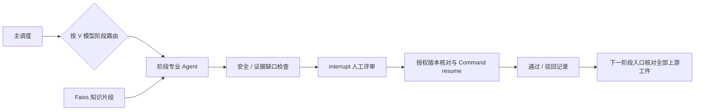

# Vehicle SW Pilot

面向汽车嵌入式软件工程的本地 MVP。React + Ant Design / Pro Components 前端，FastAPI + LangGraph / LangChain 后端，Faiss 知识检索，SQLite 工件、版本、审计日志和持久化流程检查点。

## 启动

当前工作区已经安装前后端依赖。

```powershell
# 终端 1：前端。此环境没有全局 npm，提供工作区内的 npm。
node .tools/npm/package/bin/npm-cli.js run dev

# 终端 2：后端。复制配置后编辑令牌与 API Key。
Copy-Item .env.example .env
.\.venv\Scripts\python.exe -m uvicorn backend.main:app --host 127.0.0.1 --port 8000 --env-file .env
```

打开 http://127.0.0.1:5173，在左下角「工作空间设置」填入 `.env` 的 `PILOT_AUTH_TOKEN`。它映射安全经理权限。可另设 `PILOT_SOFTWARE_TOKEN`、`PILOT_SYSTEM_TOKEN`、`PILOT_TEST_TOKEN` 以验证阶段授权；角色由后端令牌确定，已连接时不能从界面自行提升权限。

新环境安装：`npm install`；`python -m venv .venv`；`.\.venv\Scripts\python.exe -m pip install -r backend/requirements.txt`。没有 `.tools` 时使用正常安装的 npm。

不启动后端也可体验界面。演示工件和追溯关联存于浏览器 localStorage；演示角色只作用于演示数据。连接后端后以服务端数据为准。没有 Chat API Key 时，专业 Agent 生成各阶段独立的离线结构化模板；LangGraph 实际运行并在人工评审节点暂停。知识库支持无需 Key 的关键词入库与 BM25 检索；向量入库与检索需要 Embedding 服务。

详细功能、模型配置、Agent 输出契约与 RAG API 见 [Agent 与 RAG 使用说明](docs/AGENTS_RAG.md)。

## 已实现

- 项目看板：V 模型阶段状态、工件列表、追溯统计、待处理入口。
- 九阶段工作台：新增工件、文档编辑、版本历史、C 高亮、阶段 Agent 对话、候选输出与人工评审。
- 追溯矩阵：需求 → 设计 → 函数 → 测试关联编辑，缺失高亮、筛选、Excel 导出。
- Agent：九阶段独立提示词 / Pydantic 工件契约、已评审上游版本传递、引用与追溯校验、最多一次修订、独立安全模型评审、结构检查、人工卡点、运行记录与 token 用量。调度、安全卡点和执行控制节点不可通过提示词编辑绕过。
- 知识库：PDF / DOCX / TXT / Markdown、章节/规则切片、OpenAI 兼容 Embedding、Faiss + 中文/工程编号 BM25、RRF 融合排序与去重多样性选择、类别/版本/ASIL/阶段过滤、引用快照、重复检测、历史版本、预览、删除、Embedding 迁移重建、检索质量评估。
- Markdown / Word / PDF 草稿导出，含版本、AI 标签、评审状态和证据缺口。

## 编排与评审



专业 Agent 分别负责系统需求、软件需求、软件架构、详细设计、编码、单元测试、集成测试、系统测试、验收。每个阶段采用独立结构化契约。主调度负责固定输入版本与阶段路由，契约节点检查 ASIL、标识、追溯与引用并最多要求一次修订；安全节点结合确定性检查与独立模型评审。代码结构提示会保存文件名和行号，但不表示实际 MISRA 扫描。

执行 Agent 实现受限 Docker C 编译 / C test harness 运行，需本机 Docker、预先准备的编译器镜像以及 `PILOT_ENABLE_CONTAINER_EXECUTION=1`。代码与 harness 必须已评审；禁用网络、只读容器与输入、资源/时间/输出限制。当前环境没有 Docker，真实编译 / 容器测试未验证；SIL/HIL 尚未集成。

所有 AI 候选工件强制标注「AI 生成，需人工评审」。后端检查全部上游阶段已批准后，才允许生成或批准下游工件。保存新版本会取消当前批准并使已批准下游工件失效。旧版本、旧输入基线、未处理 error 级安全发现和重复恢复都会拦截批准。人工编辑会清除旧结构化输出/安全结论/执行证据并将旧运行标记 superseded，原记录保留在版本历史；修订后可独立评审。人工批准后追溯建议写入矩阵，并绑定工件版本。SQLite checkpoint 可在服务重启后恢复。

## 验证

```powershell
node .tools/npm/package/bin/npm-cli.js run build
.\.venv\Scripts\python.exe -m pytest tests -q
node node_modules/@playwright/test/cli.js test
```

浏览器验证默认使用系统 Edge，在 5175 / 8011 启动独立前后端及临时数据库，不会加载用户 `.env` 或调用外部模型。截图生成在 `artifacts/`。后端测试包括离线模板与模拟 OpenAI 兼容 HTTP 的结构化响应，不需要真实 API Key。

## 当前边界

这是可运行的开发基础，尚非可用于安全认证的生产系统。项目元信息与初始追溯为示例，不包含 AUTOSAR / ISO 26262 / MISRA 原文；请上传授权资料。正式 MISRA 分析器、覆盖率、SIL/HIL、HARA/FMEA/DFA 专项工具、安全论证和客户 ALM 工具尚未集成。容器执行器接口已实现但此环境未进行真实容器执行。追溯支持人工关联与评审后的 Agent 建议，尚未验证外部 ALM 中对象存在性。

当前服务为单机单进程、单示例项目，使用静态角色令牌和串行运行锁，适合本地验证。生产化需要独立用户身份、项目隔离、评审人独立性、数据库事务/恢复补偿、任务队列、可验证的外部工具结果、备份和部署访问控制。真实 LLM、Embedding 调用需用户自行配置并验证；目前测试不调用外部模型。

LangGraph 人工暂停/恢复采用官方 [interrupt API](https://reference.langchain.com/python/langgraph/types/interrupt)。界面基于官方 [Ant Design React 组件](https://ant.design/docs/react/introduce/?locale=en)。
